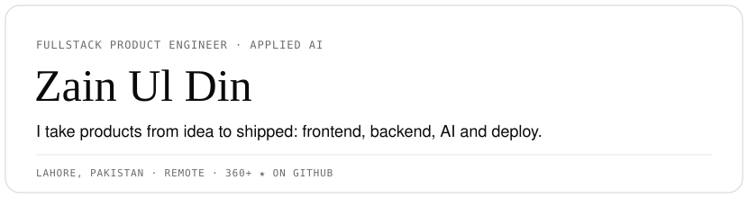
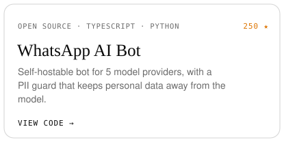
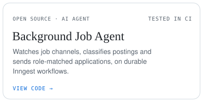
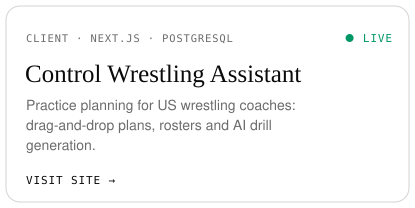
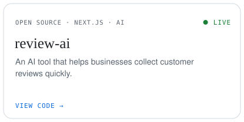
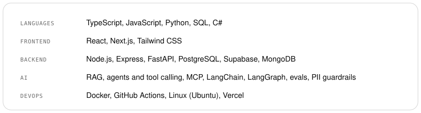
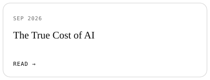
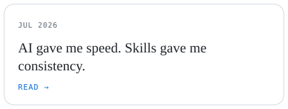

<!-- profile:start -->

<picture><source media="(prefers-color-scheme: dark)" srcset="./assets/header-dark.svg"></picture>
<a href="https://zainuldin.dev"><picture><source media="(prefers-color-scheme: dark)" srcset="./assets/link-portfolio-dark.svg"></picture></a><a href="https://www.linkedin.com/in/zain-ul-din/"><picture><source media="(prefers-color-scheme: dark)" srcset="./assets/link-linkedin-dark.svg"></picture></a><a href="https://zainuldin.dev/blog"><picture><source media="(prefers-color-scheme: dark)" srcset="./assets/link-writing-dark.svg"></picture></a><a href="mailto:zainuldin.dev@gmail.com"><picture><source media="(prefers-color-scheme: dark)" srcset="./assets/link-email-dark.svg"></picture></a>
<picture><source media="(prefers-color-scheme: dark)" srcset="./assets/section-shipped-dark.svg"></picture>
<a href="https://github.com/Zain-ul-din/whatsapp-agents"><picture><source media="(prefers-color-scheme: dark)" srcset="./assets/project-1-dark.svg"></picture></a><a href="https://github.com/Zain-ul-din/background-job-agent"><picture><source media="(prefers-color-scheme: dark)" srcset="./assets/project-2-dark.svg"></picture></a>
<a href="https://controlwrestlingassistant.com"><picture><source media="(prefers-color-scheme: dark)" srcset="./assets/project-3-dark.svg"></picture></a><a href="https://findio.pk"><picture><source media="(prefers-color-scheme: dark)" srcset="./assets/project-4-dark.svg"></picture></a>
<picture><source media="(prefers-color-scheme: dark)" srcset="./assets/section-stack-dark.svg"></picture>
<picture><source media="(prefers-color-scheme: dark)" srcset="./assets/stack-dark.svg"></picture>
<picture><source media="(prefers-color-scheme: dark)" srcset="./assets/section-writing-dark.svg"></picture>
<a href="https://zainuldin.dev/blog/the-true-cost-of-ai"><picture><source media="(prefers-color-scheme: dark)" srcset="./assets/post-1-dark.svg"></picture></a><a href="https://zainuldin.dev/blog/ai-speed-skills-consistency"><picture><source media="(prefers-color-scheme: dark)" srcset="./assets/post-2-dark.svg"></picture></a>
<a href="https://zainuldin.dev"><picture><source media="(prefers-color-scheme: dark)" srcset="./assets/footer-dark.svg"></picture></a>

<!-- profile:end -->

<a href="https://www.buymeacoffee.com/zainuldin">Buy me a coffee</a> · <a href="https://github.com/Safouene1/support-palestine-banner">#StandWithPalestine</a>

